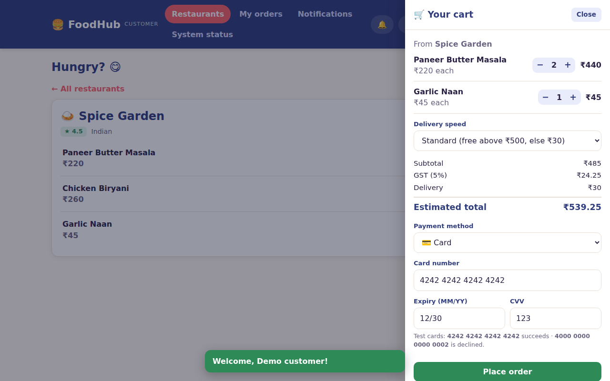
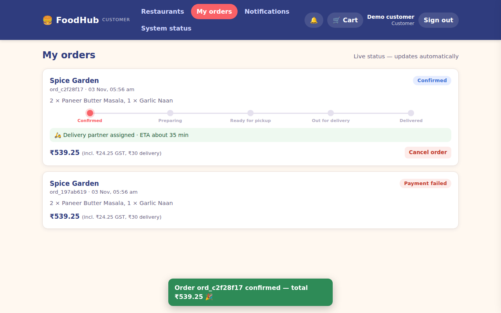
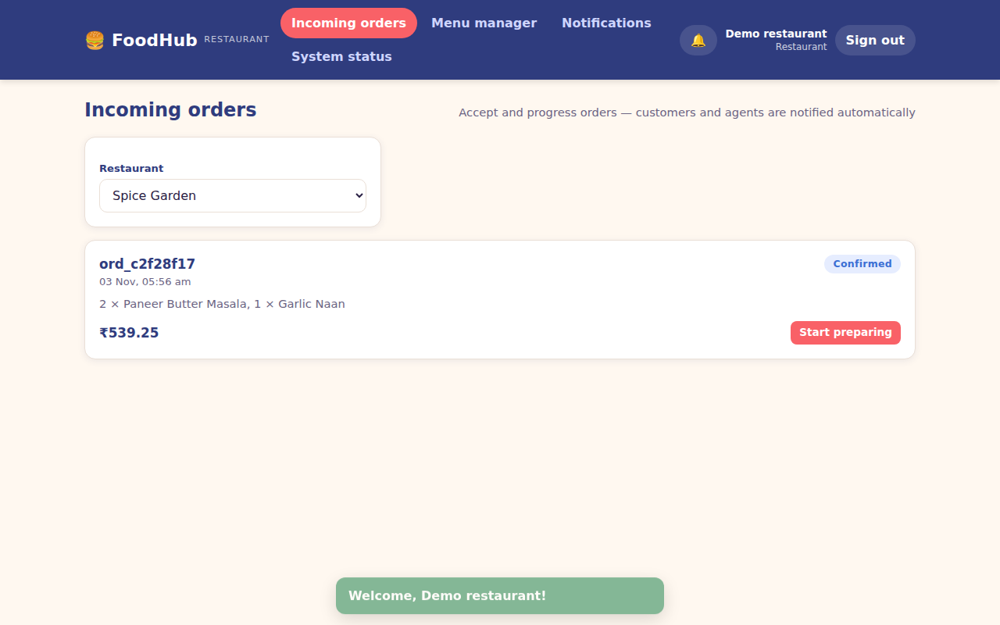
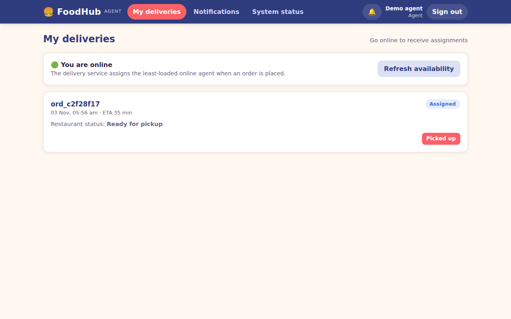

# FoodHub — Event-Driven Microservices Food Delivery Platform

Software Design & Architecture project — **Dinesh Kumar (23BCE7592)**, VIT-AP.
Focus: architecture and design decisions (see [`docs/ARCHITECTURE.md`](docs/ARCHITECTURE.md)), not framework features.
The code is deliberately **dependency-free** (Node.js standard library only) so every architectural mechanism —
gateway, circuit breaker, event bus, outbox, saga — is visible in the source instead of hidden in a library.

## Architecture at a glance

```
Clients ──► API Gateway (auth · rate-limit · routing · circuit breaker)
                │ REST (sync)
   ┌────────┬───┴─────┬──────────┬───────────┐
 User   Restaurant   Order ──► Payment     Delivery    Notification
 (own DB) (own DB, cache) (Saga)  (Strategy)  (agents)    (channels)
                         └───────── Event Bus (pub/sub, retries, dead-letter) ─────────┘
```

| Service | Port | Responsibility | Key patterns |
|---|---|---|---|
| api-gateway | 3000 | single public entry, JWT check, rate limit, proxy; also serves the web UI | API Gateway, Circuit Breaker, Token Bucket |
| user | 4001 | register / login / profile | Repository, salted scrypt hashing |
| restaurant | 4002 | catalogue + menus | Cache-aside, Repository |
| order | 4003 | order lifecycle & saga | Factory Method, State, Saga, Outbox, Circuit Breaker |
| payment | 4004 | card / UPI / wallet payments, refunds | Strategy, Idempotency, Outbox |
| delivery | 4005 | agent assignment & tracking | Observer (subscriber), least-loaded strategy |
| notification | 4006 | push / email messages | Observer (subscriber), channel list |
| event-bus | 4000 | pub/sub broker | Observer / Pub-Sub, retry + dead-letter |

## Website (web UI)

After `npm start`, open **http://localhost:3000** in a browser. The gateway serves the single-page web app
(`services/gateway/public/`, plain HTML/CSS/JS — no build step) and the API under `/api` from the same origin.

* Click one of the **Quick demo accounts** (Customer / Restaurant / Agent) or create your own account.
* **Customer:** browse restaurants → add dishes → cart → pay (card / UPI / wallet) → live order tracking, cancel with refund, notifications.
* **Restaurant:** *Incoming orders* → Start preparing → Mark ready; *Menu manager* adds dishes.
* **Delivery agent:** Go online → receive assignment → Picked up (enabled once the restaurant marks READY) → Mark delivered.
* **System status** (all roles) shows every service and circuit-breaker state from `/health`.

Best demo: open **three browser tabs** (each tab keeps its own session): customer, restaurant, agent — place an order in the
customer tab and watch the other two react through the event bus. Test cards are shown in the cart.

| Customer cart & payment | Order tracking |
|---|---|
|  |  |
| **Restaurant console** | **Delivery agent console** |
|  |  |

## Run it (no installation beyond Node.js ≥ 18)

```bash
npm start            # starts all 8 services as separate processes; gateway on http://localhost:3000
npm run demo         # (second terminal) full order journey through the gateway
npm test             # 30 tests: 18 unit + 12 black-box end-to-end (boots the whole system)
npm run loadtest     # latency / throughput measurements (set RATE_LIMIT_CAPACITY=1000000 for the gateway)
```

Windows (PowerShell): the same commands work; set variables with `$env:RATE_LIMIT_CAPACITY="1000000"`.

State is saved as JSON snapshots in `./data` (one file per service = database-per-service). Delete the folder to reset.
Set `FOODHUB_PERSIST=0` for a purely in-memory run.

## Deploy with Docker

```bash
cp .env.example .env     # then edit JWT_SECRET and INTERNAL_KEY (production mode refuses default secrets)
docker compose up --build
curl http://localhost:3000/health
```
Only the gateway port is published; the other seven services are reachable only on the private compose network.
Each service has its own data volume. (`docker-compose.yml` and `Dockerfile` are provided; CI builds the image.)

## API (all under the gateway, prefix `/api`)

| Method & path | Auth | Description |
|---|---|---|
| POST `/auth/register` | public | `{name,email,password,role}` role ∈ customer / restaurant / agent |
| POST `/auth/login` | public | returns Bearer token |
| GET `/restaurants`, `/restaurants/:id/menu` | public | cached catalogue |
| POST `/restaurants/:id/menu` | restaurant | add a menu item |
| POST `/orders` | customer | `{restaurantId, items:[{menuItemId,qty}], paymentMethod, paymentDetails, type}`; optional `x-idempotency-key` |
| GET `/orders`, `/orders/:id` | customer (own) / restaurant / admin | |
| POST `/orders/:id/cancel` | customer | triggers refund (saga compensation) |
| PATCH `/orders/:id/status` | restaurant | `PREPARING` → `READY` |
| POST `/deliveries/agents/online` | agent | join the assignment pool |
| POST `/deliveries/:orderId/pickup` · `/complete` | assigned agent | |
| GET `/deliveries` | agent | my assigned deliveries |
| GET `/notifications` | any role | own notifications |
| GET `/health` (no `/api`) | public | status of every service + circuit-breaker states |

Test payment instruments: card `4242 4242 4242 4242` (success), `4000 0000 0000 0002` (declined);
UPI `name@bank` (`fail@bank` declines); wallet starts with ₹1000.

## Repository layout

```
services/gateway/public/    web UI (index.html, style.css, app.js)
services/<name>/index.js   one deployable microservice each (order also has orderFactory.js, orderState.js; payment has strategies.js)
shared/                    cross-cutting libraries: http, auth, circuitBreaker, rateLimiter, cache, retry, repository, events, outbox, logger, config
scripts/                   start-all, demo, loadtest
tests/unit, tests/e2e      automated tests (node:test)
docs/ARCHITECTURE.md       architecture documentation, diagrams, ADRs, quality-attribute analysis
Dockerfile, docker-compose.yml, .github/workflows/ci.yml
```
