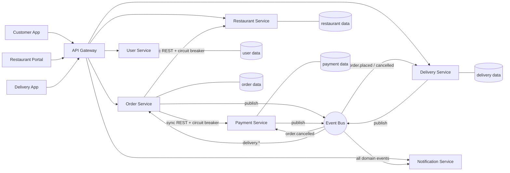
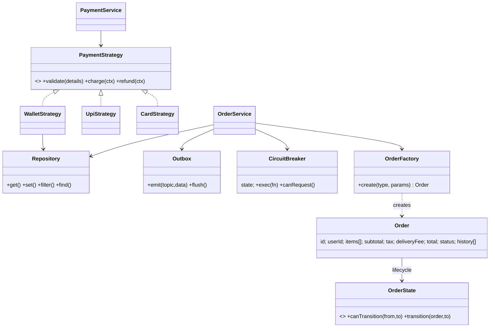
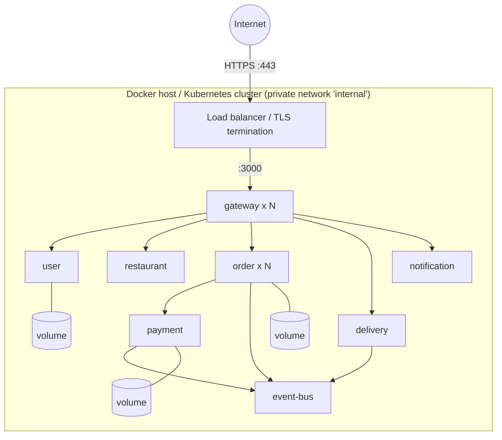
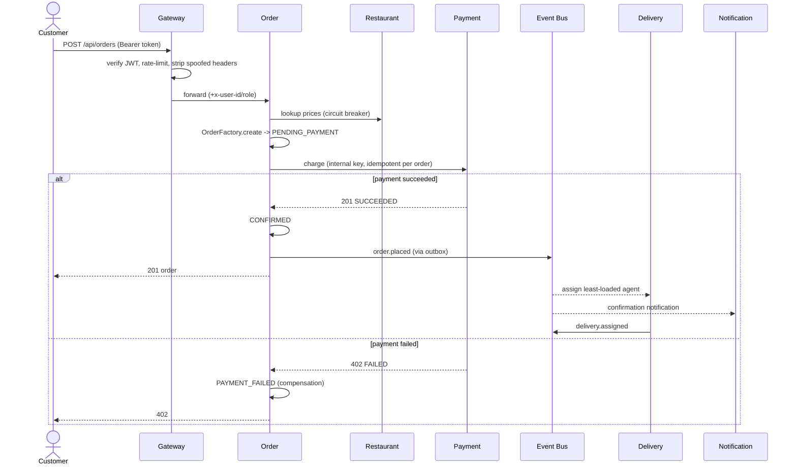
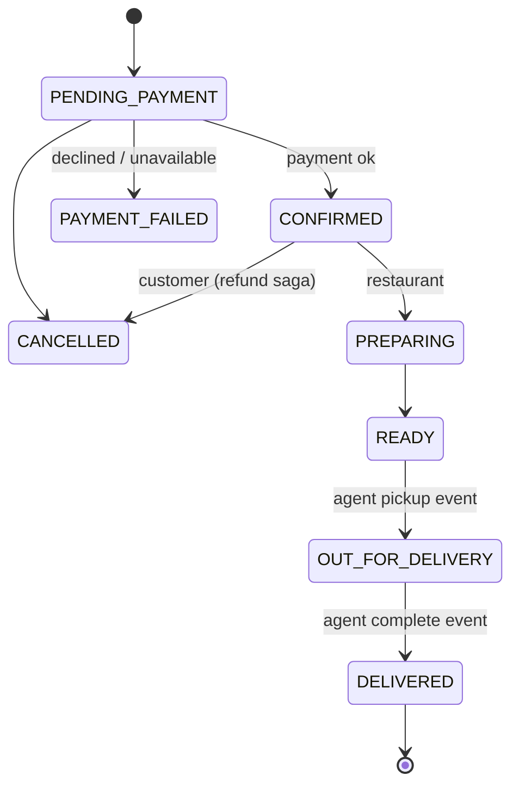
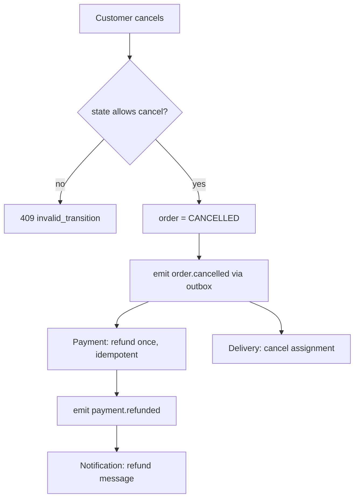

# FoodHub — Architecture & Design Documentation

> Reflects the implemented system in this repository (all claims below are backed by code and tests; measured numbers come from `scripts/loadtest.js`).
> Diagrams use Mermaid (renders on GitHub / VS Code Markdown preview).

## 1. Problem and drivers
Food delivery connects customers, restaurants and delivery agents in real time. Architecturally significant requirements:

| Quality attribute | Concrete requirement | Where addressed |
|---|---|---|
| Scalability | Lunch/festival spikes hit ordering far harder than profiles | independent services, stateless processes, async fan-out |
| Availability | A notification / delivery outage must not block checkout | event bus, circuit breakers, outbox |
| Performance | Catalogue browsing fast; checkout predictable | cache-aside, keep-alive pooling, async side-effects |
| Security | Payments & personal data | gateway auth, RBAC, hashing, internal-key, masking |
| Maintainability | Teams change one capability without touching others | bounded contexts, database-per-service, Open/Closed strategies |
| Reliability | Never lose or double-charge an order | idempotency keys, outbox, saga compensation, dedupe |

## 2. Architectural style — event-driven microservices
A hybrid of **microservices** (independent deployables, one private data store each) and **event-driven architecture**
(side-effects flow as events over a pub/sub bus), fronted by an **API Gateway**. Inside each service the code is **layered**
(HTTP routing → domain logic → repository). See ADRs in §8 for why not a monolith / pure request-response.

## 3. Structural views

### 3.1 Component diagram

### 3.2 Class diagram — order & payment subdomain

### 3.3 Deployment diagram

Delivered artefacts: `Dockerfile` (one image, `SERVICE` env selects the service), `docker-compose.yml`
(only the gateway publishes a port), GitHub Actions CI (`npm test` + `docker build`).
Production target (not implemented): Kubernetes with HPA per service, managed PostgreSQL, Kafka/RabbitMQ instead of the in-process bus, TLS at the load balancer.

### 3.4 Presentation layer (web UI)
A dependency-free single-page app (`services/gateway/public/`) served by the gateway on the same origin as the API
(no CORS, one deployable entry point). It talks only to `/api/*`; role-specific consoles for customer, restaurant and delivery agent
poll the API every 3 s (the production alternative would be server-sent events / WebSockets).
Security: strict Content-Security-Policy (`script-src 'self'`, no inline JS), all dynamic text HTML-escaped (verified by a browser test
that injects markup as a dish name), bearer token kept in `sessionStorage` and dropped on any 401, static file handler guarded against path traversal.

## 4. Behavioural views

### 4.1 Sequence — place order (Saga)

### 4.2 Activity — order lifecycle (state machine)

### 4.3 Activity — cancellation compensation

## 5. Design patterns and where they are used

| Pattern | Category | Where (file) | Problem it solves |
|---|---|---|---|
| Factory Method | Creational | `services/order/orderFactory.js` | one validated, server-priced order builder for standard / express orders |
| Strategy | Behavioural | `services/payment/strategies.js` | card / UPI / wallet are interchangeable; new method = new class (Open/Closed) |
| Observer / Pub-Sub | Behavioural | `services/event-bus`, `shared/events.js`, delivery & notification | services react to events without the publisher knowing them |
| State | Behavioural | `services/order/orderState.js` | only legal order transitions (table-driven FSM) |
| Repository | Structural/Data | `shared/repository.js` | services depend on an interface; swap JSON store for a DB |
| API Gateway (Facade/Proxy) | Structural | `services/gateway` | single entry, hides topology, centralises cross-cutting concerns |
| Circuit Breaker | Resilience | `shared/circuitBreaker.js` | fail fast when a dependency is down instead of cascading |
| Saga (orchestration) | Distributed tx | `services/order/index.js` | price → pay → confirm, compensating actions on failure/cancel |
| Transactional Outbox | Reliability | `shared/outbox.js` | event persisted before send, so a bus outage never loses it |
| Cache-aside | Performance | `shared/cache.js`, restaurant service | read-heavy catalogue |
| Token Bucket | Protection | `shared/rateLimiter.js` | per-client throttling |
| Idempotent Receiver | Reliability | `shared/events.js`, payment, order | duplicates (retries) are harmless |

Principles: **SRP** (one capability per service), **OCP** (strategies, templates, channels), **DIP** (repositories, shared interfaces),
**Separation of concerns** (cross-cutting code in `shared/`), **Database-per-service**, **least privilege** (internal endpoints unreachable from outside).

## 6. Quality-attribute analysis (with evidence)

| Attribute | Mechanism implemented | Evidence |
|---|---|---|
| Scalability | stateless service processes; per-service scaling; async side-effects; gateway/order replicas possible | one image / `SERVICE` env; load numbers §7 |
| Performance | cache-aside catalogue, keep-alive connection pooling, body-size limits, async fan-out | §7 measurements |
| Availability | circuit breakers (gateway → each upstream, order → restaurant/payment), `/health` aggregation, restart policy | unit tests: breaker open / half-open / close |
| Reliability | outbox, at-least-once bus delivery with backoff + dead-letter, idempotency key on orders, idempotent payment per order, event dedupe, refund-once | e2e: idempotency, refund-on-cancel |
| Security | JWT (HS256, expiry, constant-time compare), scrypt salted password hashing, RBAC + ownership checks, identity-header stripping at the gateway, internal-key on service-to-service endpoints, internal endpoints not routable (404), input validation, 100 KB body limit, security headers, rate limiting (429), PAN/CVV never stored, secrets masked in logs, production refuses default secrets, no user enumeration on login | unit + e2e tests |
| Maintainability | bounded contexts, every service file under 140 lines, shared libs, table-driven FSM, 30 automated tests, CI | `npm test` |

## 7. Performance measurements, bottlenecks, limitations
Environment: **1 CPU core** shared by 8 service processes *and* the load generator (so absolute numbers are conservative), Node 22, 2000 requests, concurrency 50, in-memory data.

| Scenario | Throughput | p50 | p95 | p99 |
|---|---|---|---|---|
| GET /api/restaurants (cache on) | 1144 req/s | 38.9 ms | 81.3 ms | 101.1 ms |
| GET /api/restaurants/r1/menu (cache on) | 1717 req/s | 22.5 ms | 69.4 ms | 100.8 ms |
| POST /api/orders — full saga (price + pay + confirm + event) | 248 req/s | 182.8 ms | 315.1 ms | 735.7 ms |
| Same three with cache **off** | 1194 / 1584 / 246 req/s | 35.0 / 24.4 / 195.5 ms | | |

Findings (honest):
1. **Order placement is the bottleneck** (~5-7× slower than reads): it chains gateway → order → restaurant → payment → bus synchronously, each hop being an HTTP call. Mitigations already applied: keep-alive pooling, single bulk menu lookup, async side-effects. Next steps: batch/replicate menu snapshot into the order service, run several order replicas behind the gateway.
2. **Cache effect is negligible in this setup** (99.95 % hit ratio but the same latency) because the data source is an in-memory map; the dominant cost is the proxy hop. The cache pays off once the catalogue sits behind a real database — we keep it, but we do not claim a speed-up from these numbers.
3. The gateway is a single hop in front of everything — horizontally scalable because it is stateless (rate-limit buckets are per instance; a shared store such as Redis would be needed for exact global limits).
Known limitations: no reconciliation job for an order left in PENDING_PAYMENT if the order service crashes between a successful charge and confirmation (the `payment.confirmed` event already exists to build one); JSON-file persistence (not a production DB); in-process event bus is a single point of failure and has no persistence of its own (mitigated by outbox + periodic re-subscription); JWT secret rotation and refresh tokens not implemented; no TLS inside the demo (terminated at the load balancer in production).

## 8. Trade-offs and decisions (ADR summary)

| # | Decision | Alternatives | Why chosen | Cost accepted |
|---|---|---|---|---|
| 1 | Microservices | monolith, modular monolith | independent scaling / failure isolation / team ownership match the domain | operational complexity, distributed debugging |
| 2 | Database-per-service | shared DB | no schema coupling | no joins; consistency via events |
| 3 | Async events for side-effects | chained sync calls | checkout isolated from notification/delivery failures | eventual consistency, duplicate handling needed |
| 4 | Saga (orchestrated) | 2-Phase Commit | no distributed locks, tolerates partial failure | compensation logic must be written |
| 5 | Orchestration in Order service | choreography only | one place shows the order flow | order service knows more |
| 6 | REST/JSON | gRPC | simple for browser/mobile, easy to demo & test | larger payloads |
| 7 | Zero-dependency Node.js | Express/NestJS, Kafka, Redis | architecture visible in code; runs anywhere with Node | we re-implemented small pieces (router, bus) |
| 8 | Custom lightweight bus | Kafka / RabbitMQ | no infra needed for a course project | not durable by itself → outbox added |
| 9 | HS256 JWT verified at the gateway | session store / OAuth server | stateless, scales horizontally | revocation needs short TTL |
| 10 | Table-driven FSM | scattered `if` checks | one auditable source of legal transitions | extra file |
| 11 | Web UI served by the gateway | separate SPA host / CDN | same origin, no CORS, one entry point to secure | gateway also serves static files (move to CDN at scale) |
| 12 | Delivery keeps a local copy of order status from events | synchronous call to Order service on pickup | agent pickup is validated (must be READY) without a runtime dependency on Order | eventual consistency window of a few ms |
